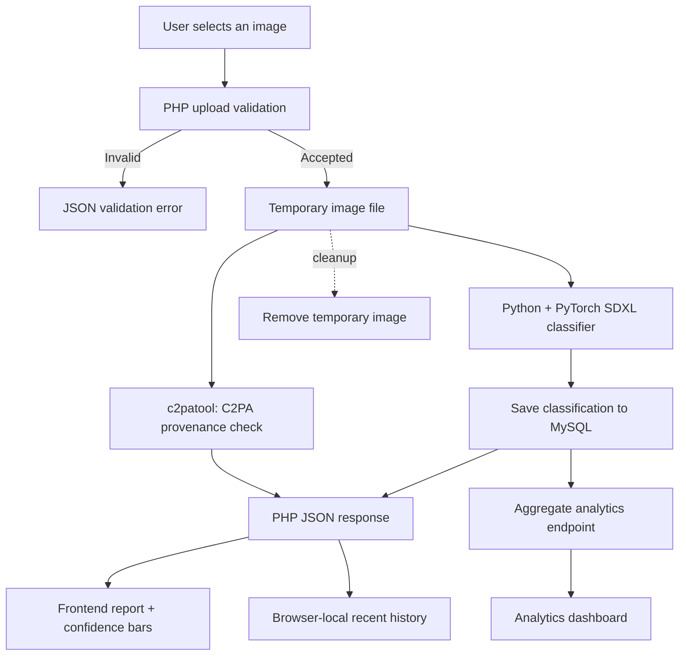

<div align="center">

# 🛡️ AI Image Detector

### AI-image classification · Content Credentials verification · Analysis analytics

**A single-model, Dockerized image-forensics web application built with PHP, Python, PyTorch, MySQL, and C2PA.**

<p>
  
  
  
  
  
  
  
</p>

**Current baseline: `Organika/sdxl-detector` only.**  
*The planned Community Forensics comparison model is intentionally **not included** in this version.*

[Features](#-features) · [Quick Start](#-quick-start-with-docker) · [How It Works](#-how-it-works) · [API](#-api-reference) · [Security](#-security-notes) · [Troubleshooting](#-troubleshooting)

</div>

---

> [!IMPORTANT]
> This application provides **model estimates and provenance observations**, not proof that an image is authentic or AI-generated. In particular, a high classifier score is **not** a calibrated guarantee of correctness. Missing C2PA credentials do **not** imply that an image is human-created.

## ✨ Features

| Feature | What it does |
|:--|:--|
| 🖼️ **Image upload** | Drag-and-drop or select **JPEG, PNG, or WebP** images, with a **2 MB** application-level limit. |
| 🧠 **AI classification** | Runs the locally stored [`Organika/sdxl-detector`](https://huggingface.co/Organika/sdxl-detector) model through Python, Transformers, and PyTorch. |
| 📊 **Visual results** | Displays separate **AI** and **human** model scores with animated confidence bars and a loading indicator. |
| 🪪 **C2PA verification** | Uses [`c2patool`](https://github.com/contentauth/c2patool) to inspect signed Content Credentials and report their validation/trust status. |
| 🧾 **Declared origin** | Reads supported C2PA `digitalSourceType` declarations, if available. |
| 🗃️ **MySQL records** | Stores classification labels, scores, and timestamps; no need to retain the uploaded image. |
| 📈 **Analytics** | Shows aggregate counts and model-score statistics from MySQL. |
| 🕘 **Recent history** | Shows a limited recent-analysis history in the current browser's local storage. |
| 🔗 **SynthID link** | Opens Google's external SynthID verification service; **automatic SynthID detection is not integrated**. |
| 🐳 **Single container** | Runs Apache, PHP, MySQL, and Python under Supervisor in **one Ubuntu container**, without Docker Compose. |

## 🧭 How It Works



### Three different kinds of evidence

| Component | Can report | Cannot establish by itself |
|:--|:--|:--|
| **SDXL classifier** | How strongly the model favors `artificial` versus `human`. | The actual origin of every image or detection of every AI generator. |
| **C2PA** | Whether signed credentials exist, their validation state, and any supported source declarations. | AI generation when no declaration exists; a trustworthy claim when the signer is untrusted. |
| **SynthID** | **Manual external check only**, via the official site. | Automatic watermark results inside this application (not implemented). |

> [!NOTE]
> `valid_untrusted` means the credentials passed integrity checks **but their signer is not trusted** by the configured trust anchors. `not_found` means no embedded credentials were detected; it is **not** a “real photo” verdict.

## 🧰 Technology Stack

| Layer | Technology |
|:--|:--|
| Operating system | Ubuntu 24.04 (Docker image) |
| Web server | Apache HTTP Server |
| Backend | PHP |
| Frontend | HTML, CSS, vanilla JavaScript |
| Database | MySQL |
| ML runtime | Python virtual environment, PyTorch (CPU), Hugging Face Transformers, Pillow |
| Baseline detector | [`Organika/sdxl-detector`](https://huggingface.co/Organika/sdxl-detector) |
| Provenance | `c2patool` **0.28.1** with a configured C2PA trust-anchor file |
| Process manager | Supervisor |
| Container orchestration | Docker CLI (**no Docker Compose**) |

## 📁 Project Structure

```text
AI/
├── Dockerfile                 # Ubuntu image, runtime and dependencies
├── supervisord.conf          # Starts Apache and MySQL
├── apache-security.conf      # Apache hardening rules
├── index.php                 # Main website
├── api/
│   ├── analyze.php           # Upload → classify → verify → persist
│   └── stats.php             # Aggregate statistics JSON
├── includes/
│   ├── c2pa.php              # c2patool integration
│   └── ...                   # Shared PHP helpers/content
├── ml/
│   ├── detector.py           # Existing SDXL inference entry point
│   └── ...                   # Local test images (do not commit private data)
├── assets/
│   ├── css/                  # Layout, styles and animations
│   ├── js/                   # Upload, results and dashboard behavior
│   └── img/                  # Website image assets
└── README.md
```

The downloaded model is stored in a **Docker volume**, not in the Git repository:

```text
/opt/models/sdxl-detector/
```

## 🚀 Quick Start with Docker

These commands assume **Windows + Docker Desktop (Linux containers) + Git Bash**. Run them from the project root, `D:\AI`.

### Prerequisites

- Docker Desktop installed, running, and using **Linux containers**.
- Git Bash (or adapt the commands to PowerShell/Linux).
- Sufficient free RAM, disk space, and internet access for the initial image build and pretrained-model download.
- TCP port **8080** available on the Windows host.

### 1. Build the application image

```bash
cd /d/AI
docker build -t ai-detector-ubuntu .
```

### 2. Create persistent volumes

```bash
docker volume create ai-detector-mysql-data
docker volume create ai-detector-models
```

These commands are safe to repeat; they do **not** wipe existing named volumes.

### 3. Download the baseline model (first-time setup only)

If you already downloaded the model into `ai-detector-models`, **skip this step**.

```bash
MSYS_NO_PATHCONV=1 docker run --rm \
  --entrypoint /opt/ai-venv/bin/python \
  -v ai-detector-models:/opt/models \
  ai-detector-ubuntu \
  -c "from huggingface_hub import snapshot_download; snapshot_download(repo_id='Organika/sdxl-detector', local_dir='/opt/models/sdxl-detector')"
```

The temporary setup container needs a **writable** model volume. The actual web container will mount the same volume **read-only**.

### 4. Start the application

```bash
MSYS_NO_PATHCONV=1 docker run -d \
  --name ai-detector-web \
  -p 127.0.0.1:8080:80 \
  -v ai-detector-mysql-data:/var/lib/mysql \
  -v ai-detector-models:/opt/models:ro \
  ai-detector-ubuntu
```

Open **http://127.0.0.1:8080**.

> [!TIP]
> In **Git Bash**, prefix Docker commands that include Linux container paths with `MSYS_NO_PATHCONV=1` to prevent Git Bash from converting paths such as `/opt/models` into Windows paths.

### 5. Initialize MySQL (first-time setup only)

Existing installations with `ai_image_detector.analysis_results` and the restricted `www-data` MySQL account can **skip this step**. Wait for MySQL to start and check:

```bash
docker exec ai-detector-web mysqladmin ping
```

To initialize a new database, execute:

```bash
docker exec ai-detector-web mysql -e "
CREATE DATABASE IF NOT EXISTS ai_image_detector;
CREATE TABLE IF NOT EXISTS ai_image_detector.analysis_results (
    id BIGINT UNSIGNED NOT NULL AUTO_INCREMENT PRIMARY KEY,
    prediction VARCHAR(16) NOT NULL,
    ai_score DECIMAL(9,8) NOT NULL,
    human_score DECIMAL(9,8) NOT NULL,
    created_at TIMESTAMP NOT NULL DEFAULT CURRENT_TIMESTAMP,
    INDEX idx_created_at (created_at)
) ENGINE=InnoDB;
CREATE USER IF NOT EXISTS 'www-data'@'localhost' IDENTIFIED WITH auth_socket;
GRANT SELECT, INSERT ON ai_image_detector.analysis_results TO 'www-data'@'localhost';
"
```

The PHP connection uses the local MySQL Unix socket with the `www-data` operating-system user. This setup assumes Ubuntu's MySQL `auth_socket` authentication plugin is available. If the current repository already includes a database migration or initialization script, use **that project's schema** instead of creating a competing table.

Verify database access with the same user Apache uses:

```bash
docker exec -u www-data ai-detector-web \
  mysql -u www-data -D ai_image_detector \
  -e "SELECT COUNT(*) FROM analysis_results;"
```

### 6. Verify the installation

```bash
# Running container
docker ps

# MySQL
docker exec ai-detector-web mysqladmin ping

# PHP syntax
MSYS_NO_PATHCONV=1 docker exec ai-detector-web \
  php -l /var/www/html/api/analyze.php

# C2PA utility
docker exec ai-detector-web c2patool -V

# Apache configuration
docker exec ai-detector-web apache2ctl configtest

# Aggregate statistics
curl -i http://127.0.0.1:8080/api/stats.php
```

Test an image using an existing local sample (for example, `ml/test.jpg`):

```bash
curl -i --max-time 180 \
  -F "image=@ml/test.jpg" \
  http://127.0.0.1:8080/api/analyze.php
```

**Expected:** HTTP `200` plus model predictions and C2PA status. The analysis may take longer on CPU because the current implementation can load the model per request.

## 🔌 API Reference

### `POST /api/analyze.php`

Uploads an image and returns the current single model's prediction, C2PA result, and SynthID integration status.

**Request:** `multipart/form-data` with form field `image` (JPEG, PNG, or WebP; max **2 MB**).

```bash
curl -sS --max-time 180 \
  -F "image=@ml/test.jpg" \
  http://127.0.0.1:8080/api/analyze.php
```

<details>
<summary><strong>Example successful JSON response</strong></summary>

```json
{
  "success": true,
  "predictions": [
    { "label": "artificial", "score": 0.9513 },
    { "label": "human", "score": 0.0487 }
  ],
  "c2pa": {
    "status": "not_found",
    "message": "No C2PA Content Credentials found."
  },
  "synthid": {
    "status": "not_configured",
    "message": "SynthID detection is not connected."
  }
}
```

*Values are illustrative; real responses depend on the uploaded image. When C2PA credentials are found, the response may additionally include an `origin` object.*

</details>

Possible responses include `200` for successful analysis, `400` for invalid uploads, `405` for unsupported methods, and `500` if analysis fails. Additional security controls may produce `413`, `429`, or `503` where configured.

### `GET /api/stats.php`

Returns aggregate results from MySQL; it does **not** expose uploaded images.

```bash
curl -sS http://127.0.0.1:8080/api/stats.php
```

```json
{
  "success": true,
  "statistics": {
    "total": 25,
    "ai_total": 15,
    "human_total": 10,
    "average_ai_score": 61.42
  }
}
```

*Example values only.* The stored analysis count includes successful requests, not a ground-truth measure of detection accuracy.

## 🪪 Interpreting C2PA Results

| `c2pa.status` | Interpretation |
|:--|:--|
| `trusted` | Credentials verified against the configured trust anchors. |
| `valid_untrusted` | Integrity checks passed, but signer trust is **not** established. |
| `invalid` | Credential verification failed. |
| `not_found` | No embedded Content Credentials detected. |
| `present_unverified` | Credentials found, but verification status not established. |
| `unavailable` | Verification could not be performed. |

If an origin declaration is available, `c2pa.origin.type` can contain:

| Value | Declared source |
|:--|:--|
| `ai_generated_declared` | Generative-AI-created media |
| `ai_assisted_declared` | AI-generated content used in a composite |
| `digital_capture_declared` | Digital device capture |
| `unknown` | No recognized source declaration |

**Origin declarations and signature trust are separate findings.** A valid declaration from an untrusted signer is not equivalent to verified provenance. The current origin extraction reads supported actions from the **active** manifest; it does not prove the full editing history.

### SynthID status

The website links to [Google's SynthID Detector](https://synthid.com/) for **separate manual verification**. The backend deliberately reports `not_configured`: it does **not** automatically inspect SynthID watermarks.

## 🔒 Security Notes

The application has security-focused design elements, including server-side image validation, limited file size, temporary upload cleanup, parameterized database writes, a restricted MySQL application account, and an Apache security configuration.

> [!WARNING]
> **Do not assume the application is penetration-test-ready just because it runs successfully.** Review the actual code and configuration in the committed revision, and independently test upload validation, pixel/decompression limits, concurrency, request throttling, subprocess timeouts, dependency vulnerabilities, and permissions.

- **Local exposure:** The documented Docker command binds Apache to `127.0.0.1` only. Do not publish MySQL or expose this host to an untrusted network by accident.
- **User-supplied images:** Treat uploaded files and all image/C2PA parsing libraries as untrusted-input attack surfaces.
- **Data handling:** The current design saves analysis scores and timestamps in MySQL, not the original uploaded image. Uploaded files should be deleted after processing.
- **Credentials:** Do not commit passwords, API tokens, `.env` files, model caches, database contents, or sensitive test images.
- **C2PA:** A cryptographically valid manifest does **not** mean its signer is trusted or that all metadata claims are true.
- **Deployment:** The current image uses one container for several services as required for this project; production systems would normally isolate them more strongly.

Only perform security testing on systems you own or have explicit permission to test.

## 🧪 Testing Checklist

- [ ] Upload a known JPEG/PNG/WebP image successfully.
- [ ] Confirm AI and human model scores appear in the results card.
- [ ] Confirm analytics increase after a successful analysis.
- [ ] Upload a corrupted image and confirm a clean validation error.
- [ ] Verify that uploads larger than 2 MB are rejected.
- [ ] Verify `includes/` and sensitive files are not publicly accessible.
- [ ] Verify a normal image without C2PA credentials shows `not_found`.
- [ ] Verify a signed C2PA test image reports its actual validation state.
- [ ] Verify stored results survive container recreation.
- [ ] Verify no analysis leaves temporary uploaded images behind.
- [ ] Run authorized request-rate, concurrency, and resource-limit tests.

A known C2PA test image is available in the [official c2patool samples](https://github.com/contentauth/c2patool/tree/main/sample). It may be **valid but signed by an untrusted test certificate**—that is a useful expected test case, not necessarily an error.

## ♻️ Updating or Restarting the Container

### Stop/start without rebuilding

```bash
docker stop ai-detector-web
docker start ai-detector-web
```

### Rebuild after changing source code

From `D:\AI`:

```bash
docker build -t ai-detector-ubuntu .
```

**Only after the image builds successfully**, recreate the container using the same named volumes:

```bash
docker rm -f ai-detector-web
MSYS_NO_PATHCONV=1 docker run -d \
  --name ai-detector-web \
  -p 127.0.0.1:8080:80 \
  -v ai-detector-mysql-data:/var/lib/mysql \
  -v ai-detector-models:/opt/models:ro \
  ai-detector-ubuntu
```

> [!CAUTION]
> Do **not** run `docker volume rm ai-detector-mysql-data` or `docker volume rm ai-detector-models` when upgrading. Deleting these volumes can remove your analysis records or pretrained model weights.

## 🛠️ Troubleshooting

<details>
<summary><strong>HTTP 500 when analyzing an image</strong></summary>

Check Apache/PHP logs and confirm Python inference, model files, and MySQL access:

```bash
docker exec ai-detector-web sh -c 'tail -n 40 /var/log/apache2/error.log'
docker exec -u www-data ai-detector-web \
  mysql -u www-data -D ai_image_detector \
  -e "SELECT COUNT(*) FROM analysis_results;"
```

Do not enable PHP error display in public responses just to debug an exception.

</details>

<details>
<summary><strong>MySQL socket permission denied (error 13)</strong></summary>

Check `/run/mysqld` permissions and the application's MySQL account:

```bash
MSYS_NO_PATHCONV=1 docker exec ai-detector-web \
  sh -c 'ls -ld /run/mysqld; ls -l /run/mysqld/mysqld.sock'
```

In this project's setup, `/run/mysqld` needs to permit Apache's `www-data` user to traverse the directory. Fix it in the **Dockerfile/startup configuration**, not just temporarily inside a running container.

</details>

<details>
<summary><strong>Model loading fails or downloads repeatedly</strong></summary>

Verify the persistent volume contains `/opt/models/sdxl-detector` and that the application container mounts the model volume at `/opt/models:ro`. Initial downloads require the one-time writable preparation step above.

</details>

<details>
<summary><strong>“No Content Credentials found”</strong></summary>

This is common. Most ordinary files are not guaranteed to contain embedded C2PA manifests; some sites also strip them during processing. Test your C2PA integration against a **known signed sample**, not just random images.

</details>

<details>
<summary><strong>Git Bash changes paths passed to Docker</strong></summary>

Use `MSYS_NO_PATHCONV=1` before Docker commands that include Linux filesystem paths, particularly `docker exec`, `docker cp`, and volume mounts.

</details>

## 🗺️ Project Scope & Next Steps

This repository revision is the **single-model baseline**. A later revision may add a second detector and a side-by-side model-comparison interface, but neither is a feature of this snapshot.

Areas for future work include **independent accuracy evaluation**, better inference performance, further security testing, richer provenance details, and authorized automatic watermark integrations where available.

## 📚 References

- [Organika SDXL Detector — Hugging Face](https://huggingface.co/Organika/sdxl-detector)
- [c2patool — Content Authenticity Initiative](https://github.com/contentauth/c2patool)
- [C2PA specification](https://c2pa.org/specifications/specifications/)
- [Google SynthID](https://synthid.com/)
- [Docker documentation](https://docs.docker.com/)

---

<div align="center">

**Built as a Computer Science project to explore AI-image classification and verifiable content provenance.**

*Assess model output critically. Verify provenance independently. Preserve test evidence.*

</div>
